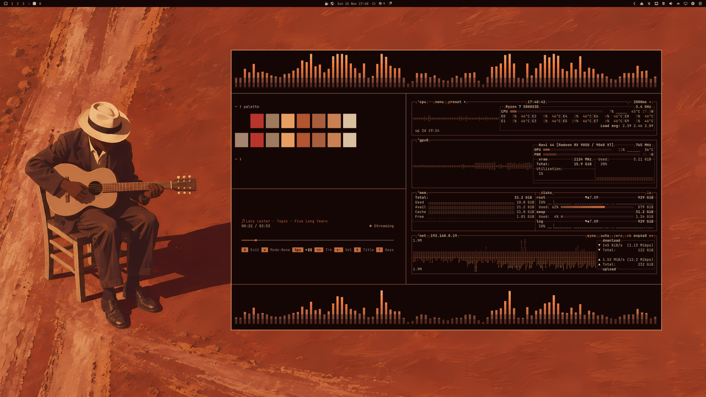
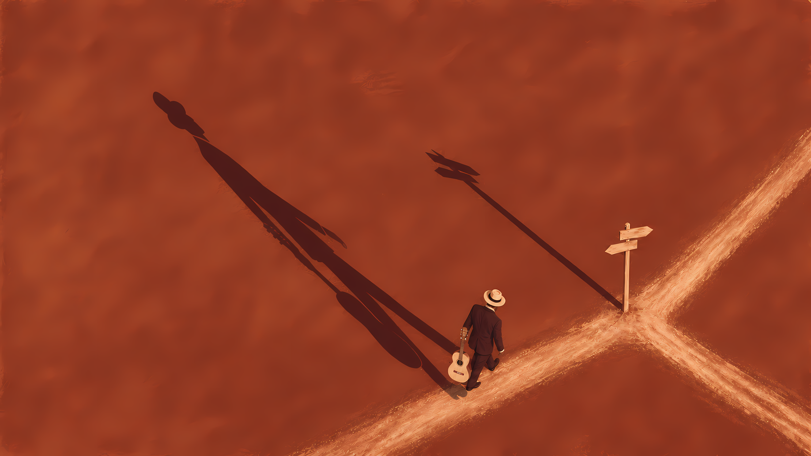
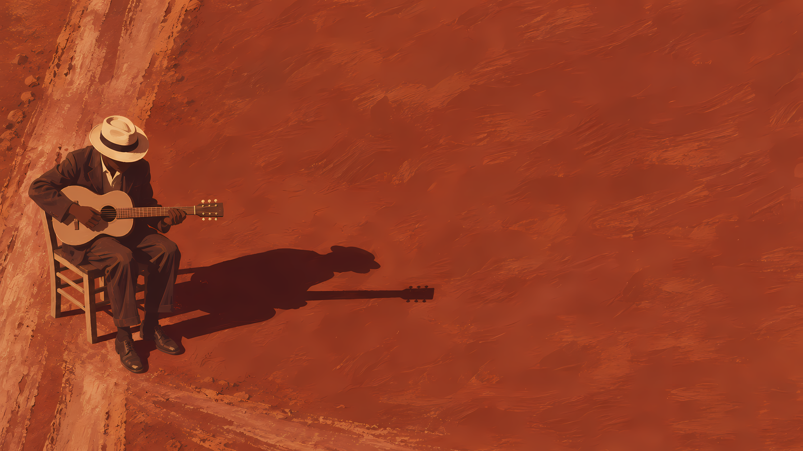
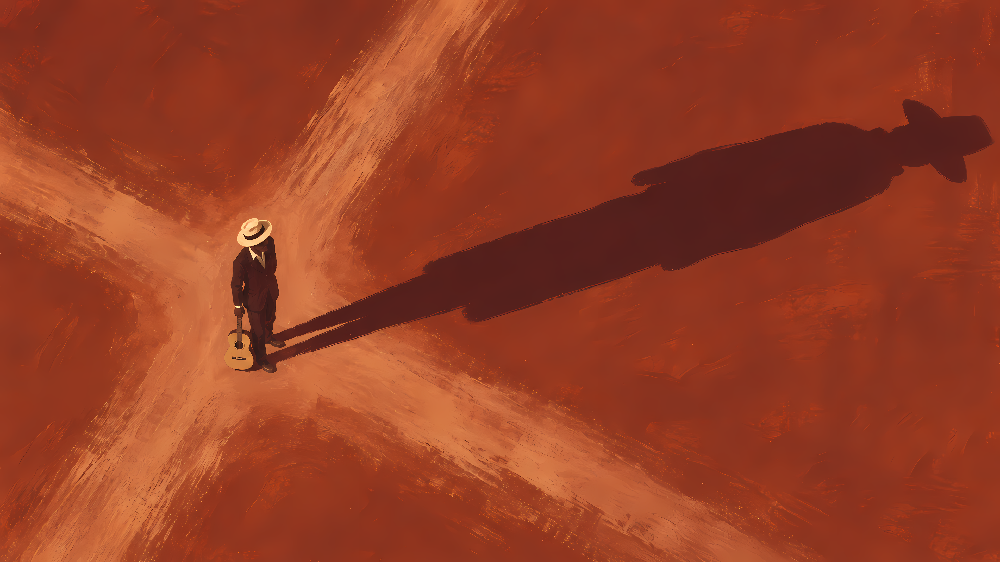
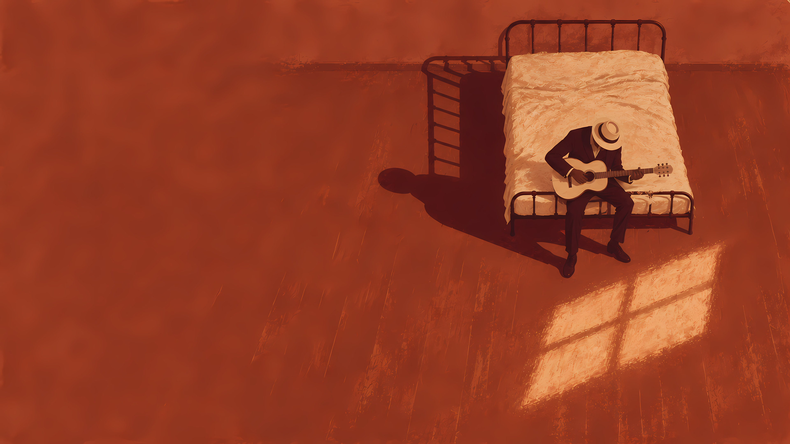
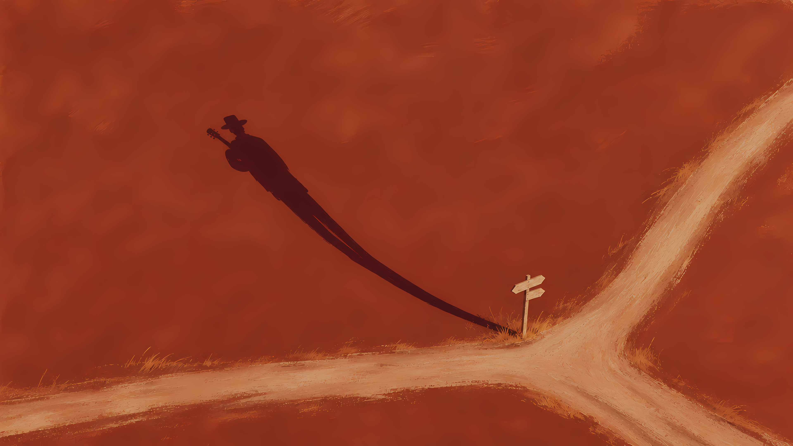

# Shellac Omarchy Theme

A rust-and-shadow Omarchy theme about a bluesman at a Mississippi Delta crossroads, 1936. The palette is painted after the cover of Robert Johnson's *King of the Delta Blues Singers*: a near-black maroon ground, paper-cream text and one warm family of rust, dust and window light, with a solid window-light edge on the focused window.

## Preview



## Install

```bash
omarchy theme install https://github.com/Devis99/omarchy-shellac-theme
```

## What's Included

- Core Omarchy colours, a solid window-light window border and a matching bar, menu, launcher, popups and lock screen.
- App themes for Discord (Vencord), GTK, Zen, Zed, btop, cava and cliamp, plus Yaru-red icons.
- Six wallpapers in `backgrounds/`.
- The palette as a Base24 scheme in `shellac-base24.yaml`.

## Palette

The ground, text and accent come from the album cover: its dark maroon shadow, its cream type and the rust of its painted ground. Every other colour is an exact main colour of the cover or the wallpapers: the red of the record, the sun orange, the window light in the room, the wall rust and the cover tans. Every app file uses only these colours. Nothing is invented to fill a slot, so there are no greens or blues; the terminal colours are one warm family separated by lightness.

It is a dark, dry theme, late afternoon rather than neon. The window light is the brightest colour on screen, and rust is the only accent.

## Wallpapers

All wallpapers are 3840x2160, painted with AI (Codex image generation) in a flat gouache style seen from above, colour-matched as a set and upscaled. The theme is released under the MIT License. This is an unofficial tribute; the album cover is not included and belongs to its owners. Scene notes are in `backgrounds/SOURCES.md`.

<table>
  <tr>
    <td><br><sub>1 The Crossing</sub></td>
    <td><br><sub>2 The Wait</sub></td>
    <td><br><sub>3 The Deal</sub></td>
  </tr>
  <tr>
    <td><br><sub>4 The Room</sub></td>
    <td><br><sub>5 The Record</sub></td>
    <td><br><sub>6 Coda</sub></td>
  </tr>
</table>
